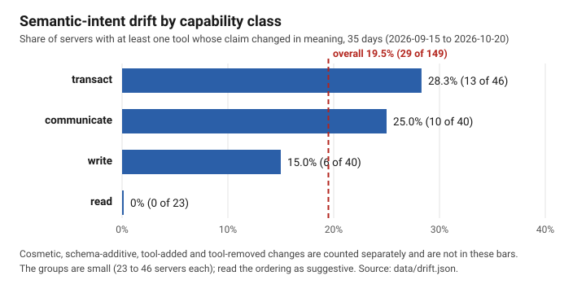
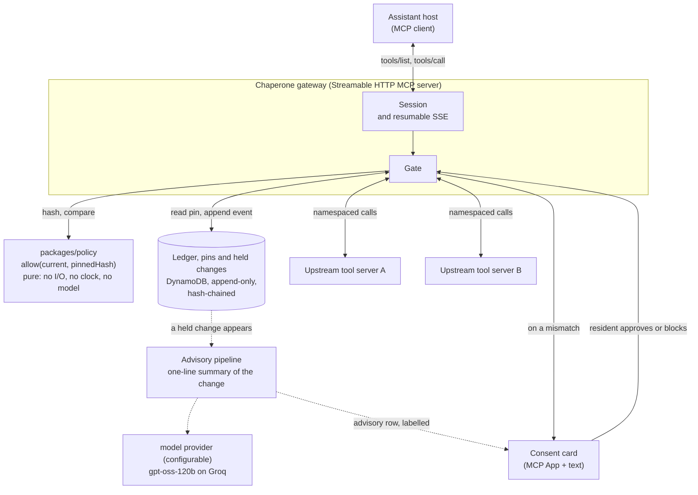

# Chaperone

An Alexa+ assistant re-reads the instructions for every tool it owns, every
time it connects, and remembers nothing about what they said last time.
Chaperone is that memory: a context-aware add-on for Alexa+ households that
maintains state across sessions. It keeps a record of what each tool claimed
the last time a resident approved it, and when a tool's own wording changes,
the resident sees the old and the new sentence side by side before anything
runs. The demo is a *simulated* Alexa+ experience, a web page in which a
rule-based stand-in plays the assistant (see the quickstart below); it is not
made by or affiliated with Amazon.

**Start here:** the MCP session handling, the part a reader checks first, is in
[`packages/gateway/src/session.ts`](packages/gateway/src/session.ts): one
`StreamableHTTPServerTransport` per session in a map, the session persisted to
DynamoDB, an unknown session answered `404`. The gateway's entry point,
[`packages/gateway/src/index.ts`](packages/gateway/src/index.ts), is 52 lines
and hands off to it.

## What it does

When a resident approves a tool for the household's assistant, Chaperone
remembers exactly what that tool said it would do. The next time the tool's
words have changed, the assistant is not allowed to use it, and the resident
sees a short card with the sentence they approved beside the sentence that
replaced it. They choose to approve the change or keep it blocked, and until
they do, every other tool carries on working.

## Why it matters beyond one household

This is a working implementation of the update gate a platform would want
before opening a commerce-capable assistant to third-party tools: approve a
tool once, keep exactly what it said, and hold it the moment those words
change. The staged grocery tool in the demo can place an order, which is the
case that makes a silently reworded description more than a curiosity.

It has a measured cost, and the part that transfers between environments is
the count: every gated call performs **four DynamoDB write operations**, one
pin read plus two resumable-SSE events, each an `UpdateItem` and a `PutItem`
(see [Cost per call](#cost-per-call-four-dynamodb-writes)). The milliseconds
do not transfer. Against DynamoDB on AWS, measured on the deployed `t3.micro`
in us-east-1 on 2026-10-16 with the bench running on the host itself, the added
latency is **p50 33.10 ms, p95 53.82 ms, p99 129.25 ms: over the 30 ms p95
budget**, as it is against DynamoDB Local.

What it is not: there is no household that has used it, it covers one
hard-coded household, and it detects changed claims, not malicious behaviour.

> **Live deployment:** a hosted copy runs on AWS during judging (2026-11-09 to
> 2026-11-20) and is taken down after submission and redeployed for that window,
> so it is not expected to be up at other times. The local `docker compose` path
> below works any time and needs no AWS account. Deploy, pause and resume steps
> are in [docs/RUNBOOK.md](docs/RUNBOOK.md); nothing there has been applied yet.

## Quickstart (no AWS account)

You need Git, Node 24 (see `.nvmrc`), pnpm 12.4.1 (`corepack enable` picks it
up from `package.json`), and Docker Desktop running. On Windows, clone into a
short path such as `C:\src\chaperone`: a deeply nested folder trips the
260-character path limit and `git clone` stops with "Filename too long".

**1. Set up** (the `docker compose` step builds two images, and is most of the
time the first time; see the measured times below):

```
git clone https://github.com/nirmalraj142007-byte/Chaperone.git
cd Chaperone
pnpm install
pnpm build
docker compose up -d --build
pnpm demo:reset
```

`pnpm demo:reset` builds the demo state (and, the first time, the console
bundle) and prints the beats. Skipping `pnpm build` fails with
`ERR_MODULE_NOT_FOUND`, because the scripts load the workspace packages from
their built output. If `docker compose up` reports that a container name is
already in use, another checkout's stack exists: run `docker compose down` in
that checkout first (the container names are fixed). `pnpm demo:reset` also
creates the DynamoDB tables; to create them on their own, run `pnpm demo:migrate`
(the bare `pnpm ddb:migrate` needs `DDB_ENDPOINT` and `CHAPERONE_UPSTREAMS` in
the environment, so it can also target a deployed table set).

**2. Run the demo.** The primary surface is the *simulated Alexa+ experience*: a
web page with a conversation, where you talk to a household assistant and the
review card appears inside the conversation. In a second terminal:

```
pnpm demo:assistant
```

then open <http://localhost:5174> and:

1. Type (or tap) **add batteries to my list**. It works: `Added 1 × batteries to
   the shopping list.`
2. In the first terminal, run `pnpm demo:mutate`. That makes the tool's server
   change `add_item`'s description, which is the thing that happens in the real
   world without anyone telling you.
3. Type **add batteries to my list** again. The tool does not run. You get the
   refusal, in words that never change, and under it the card, inside the
   conversation: the added sentence highlighted, "can change your data", "You
   approved this on 12 January".
4. Press **Approve** (or **Keep blocked**) on the card. Ask again: after an
   approval it runs; after Keep blocked it stays blocked.

A collapsible "What just happened" panel shows the tool called, the MCP session
ID, the protocol version and the latency of each call. **There is no model on
that page.** The assistant is a rule-based stand-in for the assistant's model
(fixed phrases mapped to tool calls, all in
[`packages/assistant-sim/src/rules.ts`](packages/assistant-sim/src/rules.ts)),
and the page says so on screen. What it is real about: it talks to the gateway
over MCP Streamable HTTP with the official SDK client, and it hosts the card as
an MCP App (the `ui/initialize` handshake of `@modelcontextprotocol/ext-apps`,
in a sandboxed frame), so Approve and Keep blocked are real calls to
`chaperone/approve_change`. Speech (`speechSynthesis`) is available behind a
toggle, off by default; typed input is the primary way to talk to it.

**Or, without a browser** (the command-line path; the timings below were
measured on it). Each command is copy-pasteable; run them in order:

```
pnpm demo:call
pnpm demo:call grocery__add_item item=batteries
pnpm demo:mutate
pnpm demo:call grocery__add_item item=batteries
```

1. `pnpm demo:call` lists the tools the assistant can see.
2. The first `add_item` works: `Added 1 × batteries to the shopping list.`
3. `pnpm demo:mutate` makes the tool's server change `add_item`'s description,
   which is the thing that happens in the real world without anyone telling
   you.
4. The second `add_item` is refused, in words that never change, followed by
   the card: the added sentence marked `{+ +}`, "can change your data", "You
   approved this on 12 January", and two lines that begin `[Approve]` and
   `[Keep blocked]`.

Copy the `[Approve]` line from the card, put `pnpm demo:call` in front of it,
and run it. Then:

```
pnpm demo:call grocery__add_item item=batteries
pnpm demo:ledger
```

The tool works again, and `pnpm demo:ledger` walks the household's hash chain
and prints `chain OK — 9 events verified`.

Optional, in a second terminal, to see the supporting operator console (the held change, the ledger, the evidence so far):

```
pnpm --filter @chaperone/console exec vite preview
```

then open <http://localhost:4173/queue> (the held change and its card),
`/ledger` (the chain), and `/corpus` (the evidence so far). `pnpm demo:reset`
puts everything back for another run.

To check all of it headlessly: `pnpm demo:verify` walks the same beats in a real
browser and asserts each one, including the drift chart, which it checks against
`data/drift.json`. It needs Chromium once:
`pnpm exec playwright install chromium`.

**Two things in the demo are hand-written stand-ins, and both are labelled on
screen.** The one-line "advisory" on the card is a fixture, not model output,
and the household's "12 January" approval history is staged. Everything else,
the check, the refusal text, the hashes and the ledger, is the real code.
[`demo/OFFLINE.md`](demo/OFFLINE.md) lists exactly which is which.

**Measured**, from a fresh clone of commit `bafc5f5` on the author's Windows 11
laptop (16 threads, Docker Desktop, about 2 GB of free RAM), running every
command above in order, then the seven demo commands (a script pulled the
`[Approve]` line out of the card instead of a person copying it); the times are
seconds from the start of `git clone` to `chain OK`:

| Run | Clone | install | build | compose up | demo:reset | demo commands | **Total** |
|---|---:|---:|---:|---:|---:|---:|---:|
| First run: Docker had to build both images | 4 | 36 | 12 | 328 | 91 | 50 | **521** (8 min 41 s) |
| Second run: images and the pnpm store already cached | 6 | 18 | 7 | 15 | 16 | 19 | **81** |

So "about 90 seconds" is the warm figure. **The first time, expect several
minutes** (8 min 41 s above), almost all of it Docker building two images, plus
the demo building the console bundle. For scale, a separate
`docker compose build --no-cache` of the same Dockerfiles took 106 s when run
on its own; why the build inside the first row took 328 s was not established,
and this laptop has little memory to spare. A machine with a warm Docker cache,
which is the state "ready to film" means, is the 81 s row.

**One-time online prerequisites**, from [`demo/OFFLINE.md`](demo/OFFLINE.md).
After these, the demo needs no network at all:

```
pnpm install
pnpm build
docker compose build                       # builds the gateway and demo-upstream images
docker compose pull ddb                    # DynamoDB Local
docker pull alpine/socat                   # only for the no-egress overlay
pnpm exec playwright install chromium      # only for demo:verify
```

## What this does not prove

This is the audit of the claims this project could have made and does not.

- **"Quarantine caught 100% of changed tools" is cut from every claim.** It is
  a hash comparison run against an attack corpus the author wrote, so it
  cannot come out any other way. It is **tautological**: a correctness
  property, not a result. A block rate is reported only as a delta against
  baseline 2 (an unaided model), never as an absolute, and `packages/eval` has
  a test that fails if an absolute leaks into a report.
- **The drift rate came in just under the pre-registered range.** 29 of 149
  servers (19.5%, 95% Wilson interval 13.9% to 26.6%) showed semantic-intent
  drift over 35 days; the prediction, committed before crawl 1, was 20 to 40%.
  One more drifted server would have made it 20.1%. The interval spans the
  whole boundary, so this is a near miss, not a refutation. The four capability
  groups hold 23 to 46 servers each, which is too few to rank them firmly.
- **Baseline 2 is one model, one provider, one day.** `gpt-oss-120b` on Groq
  (Bedrock access for this AWS account was declined), 90 attack runs. Its
  55.6% follow rate is a floor and says nothing about any other model, and
  "AI models" is never the subject of a sentence about it.
- **The sample is the servers that boot without credentials**, 152 of 947
  candidates. That likely understates drift.
- **The interim crawl is a rehearsal, not a result.** On 2026-10-02, 17 days
  after crawl 1, 130 tool changes were found in 24 of the 152 servers captured
  in both. All 130 labels were made by hand by the author with no proposed
  class shown. They replace a pilot set (kept in `data/labels-pilot-v1.json`)
  that tracked the tool's proposal on 115 of 130 and agreed with two blind AI
  runs on only 54.6% and 45.4%. The relabel was done after seeing those AI
  results, so its 81.5% and 78.5% agreement with them is not independent.
  The crawl-2 labels were checked independently, by a blind AI run made after
  they were locked (see "Crawl 2 and drift" below). The interim crawl is
  structure-only and is never a headline.
- **Classifying a change is one person's reading.** Detecting that a change
  happened is not: it is a hash comparison. Deciding whether it was cosmetic,
  additive or a change of meaning is the author reading it.
- **The 30 ms latency budget is not met.** It fails against DynamoDB Local
  and against DynamoDB on AWS, measured on the deployed host (added p95
  53.82 ms, 23.82 ms over).
- **It detects changed claims, not malicious behaviour.**

The reasoning behind each is in [`docs/LIMITATIONS.md`](docs/LIMITATIONS.md),
and the questions a reviewer is likely to ask are answered in
[`docs/QA.md`](docs/QA.md).

## The numbers

Each number has its provenance and the command or file that reproduces it.
Anything not measured is said to be unmeasured. No value has been estimated to
fill a gap.

### Crawl 1 (2026-09-15)

Started 2026-09-15T06:19:42.282Z, finished 06:51:29.907Z
(`data/crawl-1-report.json`). The candidate list is frozen
(`corpus/candidates.json`) and crawl 2 runs against it unchanged.

| | Value | Source | Reproduce |
|---|---:|---|---|
| Candidate servers | 947 | `data/crawl-1-report.json` | `corpus/candidates-README.md` explains where they came from |
| No discoverable install command | 656 | `data/boot-rate.json` | `pnpm crawl:boot-rate --crawl-id=crawl-1` |
| Attempted | 291 | `data/boot-rate.json` | same |
| **Captured** (booted, tool list read) | **152** | `data/boot-rate.json` | same |
| **Did not start from their own setup instructions** | **47.8%** (139 of 291) | `data/boot-rate.json` | same |
| Tools captured | 6,058 | `data/crawl-1-report.json` | same |

`pnpm crawl:boot-rate` re-derives the boot figures from the committed report
and rewrites `data/boot-rate.json` (verified 2026-09-24: identical output; the copy
under `benchmarks/` is written by `pnpm bench`). It does not re-run the crawl. The crawl itself
(`pnpm crawl:run`) is not something to run casually; see `CLAUDE.md`.

**Capability distribution under classifier v2**
(`data/crawl-1-capabilities-v2.json`, reproduced by `pnpm crawl:reclassify-v2`):

| Class | Tools | Share |
|---|---:|---:|
| read | 4,185 | 69.1% |
| write | 1,300 | 21.5% |
| communicate | 371 | 6.1% |
| transact | 202 | 3.3% |

This is the corrected distribution. The first classifier (v1) had no verb
matching "add" and missed 196 tools that write (write was 18.2%, now 21.5%).
`read` is the residual class: every one of its 4,185 verdicts is low
confidence. The correction and what it does and does not establish are in
[`docs/LIMITATIONS.md`](docs/LIMITATIONS.md).

### Baseline 1: a regex blocklist

Against the 30-item author-written attack corpus (`corpus/attacks/`) and 40
benign definitions: **15 of 30 detected (50.0%), 0 of 40 false positives.**
By pattern: direct-instruction 0/6, false-authority 6/6, data-exfiltration 3/6,
scope-widening 2/6, delayed-trigger 4/6. Source: `data/baselines.json`;
reproduce with `pnpm eval:report`. It is a comparison point, not a headline.

### Cost per call: four DynamoDB writes

Every gated `tools/call` performs one pin read plus two resumable-SSE event
store events, each an `UpdateItem` and a `PutItem`: **four DynamoDB write
operations per call.** That is a property of Chaperone and transfers between
environments (`benchmarks/latency.json`, `environment.storageWritesPerToolCall`).
The milliseconds do not transfer, because they belong to the storage backend.

Measured at concurrency 4, 1000 samples per mode, against **DynamoDB Local**
(a single-writer SQLite process that saturates at roughly 60 writes per
second), on one machine, at commit `e7a453b` on a dirty tree:

| Backend | Added p50 | Added p95 | Added p99 |
|---|---:|---:|---:|
| `dynamodb-local` | 480.53 ms | 591.89 ms | 635.63 ms |
| `dynamodb-aws`, on the host | 33.10 ms | 53.82 ms | 129.25 ms |

The `dynamodb-local` row is Chaperone's added latency against a single-writer
local backend, not its added latency.

The `dynamodb-aws` row was measured on 2026-10-16 on the deployed `t3.micro`
in us-east-1 (gateway image `60e5967`), by the bench at commit `502d3d0` on a
clean tree, running in a container on the host's own compose network: the
direct call goes to `demo-upstream:4000` and the proxied one to `gateway:3000`,
so both stay on the instance and only the gateway's DynamoDB calls leave it.
Direct p50 was 2.60 ms. 1000 samples per mode at concurrency 4, **paced at 8
calls per second**: the gateway rate-limits each client IP to 10/s, and one
bench process is one IP, so an unpaced run on the host measures the limiter's
"Too many requests", not a tool call. A household's assistant is one client
too. CPU credits were not a factor (`unlimited` mode, balance rising through
the run, no surplus spent, CPU at most 14%). DynamoDB itself reported 2.1 ms
per `PutItem`, 2.3 ms per `UpdateItem` and 0.9 ms per pin `GetItem` in that
window, roughly 9 ms of server time per call; where the rest of the 33 ms goes
is not established. `benchmarks/latency.json` records `environment.vantage`
`on-host` and `instanceType` `t3.micro`.

An earlier run the same day reported added p95 835.78 ms. It measured an SSM
tunnel from a laptop in India, not Chaperone, and is kept, unedited, as
superseded in [`benchmarks/superseded/`](benchmarks/superseded/README.md).
Method: [`docs/RUNBOOK.md`](docs/RUNBOOK.md#latency-against-dynamodb-on-aws). The 30 ms p95 budget is enforced by exit code: `pnpm bench`
exits 1 over budget, and **it currently exits 1 against both backends.** The bench file records the
backend as a required field so a number cannot be quoted without it.
Resumable SSE is why the writes exist: an event a client could replay with
`Last-Event-ID` has to be durable before the response goes out.

### Tests

| Command | Result |
|---|---|
| `pnpm test` | 1,174 tests in 106 files, all passing (run 2026-10-21), with coverage gates |
| `pnpm spec` | 27 named conformance assertions, all passing (run 2026-10-21) |
| `pnpm test:stack` | 16 tests in 4 files, all passing: ten kill-and-resume iterations, a held-open stream, ledger tamper detection, "refused stays refused" |
| `pnpm test:e2e` | 4 Playwright tests in 2 specs, all passing (38.6 s) |
| `pnpm test:all` | exit 0 in 327 s from a fresh clone of `bafc5f5` on 2026-09-24; it also ends with `verify-ledger` green. See [`docs/TESTING.md`](docs/TESTING.md) |

`packages/policy` is gated at 100% statements and branches; the rest at 80%.

### Baseline 2: an unaided model against the attack corpus (2026-10-03)

`gpt-oss-120b` (an open-weight model, served by Groq), temperature 1, given
each of the 30 attack tool descriptions with no Chaperone in front of it, in a
two-turn setup: it may call the tool, is handed a canned tool result, and
writes a final message. Of 90 runs it **followed the injected instruction in
50 (55.6%), explicitly refused 0, and did not exercise 40.** The 50 are 46
follows by the rubric's markers plus 4 that a human reviewed and decided were
follows (a human decided 2 others were not). Of the 40, the model saw the result and showed none of it in 22, asked a
question or answered without calling the tool in 15, and the trigger was
unreachable in 3. It refused 0 of 30 benign-control runs. A hash
comparison has no follow rate, so the delta is 100 points: the model never said
no. The follow rate is a floor: it needs a literal marker, and the scenario
gives the model invented household data and trigger facts so the attacks are
possible. One open-weight model, one provider, one day; it says nothing about
other models. The scoring rules were committed before the run
([`docs/BASELINE2-RUBRIC.md`](docs/BASELINE2-RUBRIC.md)). Numbers in
`data/baselines.json`, every response in `data/baseline2-raw.json`, the full
account in [`docs/LIMITATIONS.md`](docs/LIMITATIONS.md). Re-score with no
model calls: `pnpm eval:baseline2`. A single-turn first attempt, mostly
unmeasured, is kept as superseded.

### Instruction-shaped descriptions (prediction 2)

Of 150 tools drawn from the 6,058 captured at crawl 1, the author labelled **13
as instruction-shaped: 8.7% (13/150), 95% Wilson interval 5.1% to 14.3%.** The
point estimate is within the pre-registered prediction of 5-12%
(`corpus/PREDICTIONS.md`); the interval's upper end is above 12%, so the sample
does not by itself exclude a rate outside that range. The sample was
stratified by capability class with proportional allocation, so it is
self-weighting and needs no weights for the whole corpus; weighting by stratum
size gives 8.7% (8.71%), the same figure. A blind AI cross-check agreed on
97.3% of the 150 (kappa 0.85) and found 4 more `yes` than the author; the
author's answers were not changed (`data/prevalence-agreement.json`,
[`docs/LIMITATIONS.md`](docs/LIMITATIONS.md)). `data/prevalence.json`.

### Crawl 2 and drift (2026-10-20)

Crawl 2 started 2026-10-20T06:29:28.731Z (`data/crawl-2-report.json`) against
the candidate list exactly as frozen at crawl 1. Crawl 1 started
2026-09-15T06:19:42.282Z: **35 days** apart. 149 servers were captured in both
crawls (3 of crawl 1's 152 did not boot in crawl 2 and are not in the
denominator). All figures below are from `data/drift.json`.

**Headline: 29 of 149 servers (19.5%, 95% Wilson interval 13.9% to 26.6%)
showed semantic-intent drift over 35 days (2026-09-15 to 2026-10-20). That is
just under the pre-registered 20 to 40% range.** Only `semantic-intent`
changes, the ones that change what a tool claims to do, count toward it.



| Capability class | Servers drifted | Rate |
|---|---:|---:|
| transact | 13 of 46 | 28.3% |
| communicate | 10 of 40 | 25.0% |
| write | 6 of 40 | 15.0% |
| read | 0 of 23 | 0% |

The strata are small (23 to 46 servers each), so the ordering is suggestive and
the individual rates are wide: the 95% Wilson interval for transact is 17.3% to
42.5%, and for read, 0 of 23, it runs from 0% to 14.3%.

**Counted separately, never in the headline** (unit: tools, 5,838 paired tools
in the 149 servers): 110 cosmetic, 91 schema-additive, 77 tools added and 57
tools removed (115 tools had a semantic-intent change). Three servers present
in crawl 1 were absent in crawl 2 (163 tools), outside the pairing. No change
observed at the interim crawl had reverted by crawl 2.

**Pre-registered predictions** (`corpus/PREDICTIONS.md`, unedited since
2026-09-12), scored here and only here:

| # | Prediction | Measured | Result |
|---|---|---|---|
| 1 | Semantic-intent drift 20-40% | 19.5% (29 of 149), interval 13.9-26.6% | **Just missed**, below the floor by 0.5 points |
| 2 | Instruction-shaped descriptions 5-12% | 8.7% (13 of 150), interval 5.1-14.3% | **Met** on the point estimate; the interval's upper end is above 12% |
| 3 | Given drift of 20% or more, fewer than 30% of drifted servers publish a signal | Not run | **Untested**: its condition was not met |
| 4 | An unaided model refuses 70-85% of the attack corpus | `gpt-oss-120b`: followed 50 of 90 runs (55.6%), explicitly refused 0, did not exercise 40 (44.4%) | **Missed**, on either reading: 0% refused, 44.4% not followed. One model, one provider, one day |

Prediction 3 is conditional on drift of at least 20%. The gate for the signal
check (rider C) was 20% with at least 100 servers; the measured rate was 19.5%,
so the check was not run and the prediction is neither confirmed nor refuted.

**Label reliability.** Whether a change is cosmetic, schema-additive or
semantic-intent is one person's reading, so the 274 crawl-2 labels were
checked by an independent blind AI run (claude-sonnet-5-5). The hand labels
were locked and pushed first (commit `9d3411c`); the AI labelled all 274 from
the raw definitions without seeing them and committed its labels on their own
(`c53afef`) before any comparison. They agree on 194 of 274 (70.8%), Cohen's
kappa 0.53 (moderate). The AI was stricter: on its labels 34 of 149 servers
(22.8%) would have drifted, against the author's 29, so the author's figure is
the conservative one. The human labels decide the headline, as pre-registered;
the AI run is a consistency check, not ground truth, and not a second human
(`data/labels-agreement-crawl2.json`, `data/labels-blind-ai-crawl2.json`).

**Prevalence (prediction 2).** 8.7% (13 of 150, 95% Wilson interval 5.1% to
14.3%), kappa 0.85 against a blind AI check (see above;
`data/prevalence.json`, `data/prevalence-agreement.json`).

## Architecture



The solid path is everything that decides whether a tool runs. The dashed
branch is off that path: it can be slow, wrong or absent and the gate reads
none of it. Source for the diagram is this block; it is committed as text.

Internally the gateway is a spec-2025-11-25 Streamable HTTP MCP server that
proxies N upstream servers. The entire security property is a synchronous hash
comparison in `packages/policy`, with no language model anywhere in that
package's import graph, enforced by `pnpm depcruise`. Denied tools are left
out of `tools/list` rather than annotated. Tool names are namespaced
`{upstreamId}__{toolName}`, the one place the gateway is deliberately not
byte-transparent, and that is asserted in the conformance suite rather than
hidden. Storage failures fail closed: if a pin cannot be read the tool is
withheld, and `/healthz` returning 503 never means permissive.

## Spec conformance

- **Revision:** MCP `2025-11-25`, on `@modelcontextprotocol/sdk` 1.30.0.
- **Transport:** Streamable HTTP on `/mcp`. A POST without the required
  `Accept` header gets 406, and a disallowed `Origin` gets 403.
- **Session lifecycle:** `initialize` with `2025-11-25` mints a session id;
  an older revision is refused with 400 naming both versions; a request with no
  `Mcp-Session-Id` gets 400 and an unknown one gets 404; `DELETE` terminates
  a session and later requests against it 404; two clients get two independent
  sessions.
- **Resumability:** every SSE event is durable in DynamoDB before it is sent,
  so a client that loses its connection resumes with `Last-Event-ID` and gets
  the events it missed. `pnpm test:resume` runs ten independent
  kill-the-connection-and-resume iterations and asserts `place_order` ran
  exactly once each time, counted by the upstream itself.
- **Also asserted:** progress notifications arrive in order and before the
  result, a downstream cancel reaches the real upstream, and JSON-RPC errors
  keep their reserved codes (`-32601` for an unknown method, `-32700` for
  malformed JSON).

To run the conformance suite: `pnpm spec` (in-process, needs no Docker, about
20 seconds). Its named assertions are printed as it runs, and the resumption
and long-stream suites that need a live stack are in `pnpm test:stack`. See
[`docs/TESTING.md`](docs/TESTING.md).

## Evidence and pre-registration

`corpus/TAXONOMY.md` and `corpus/PREDICTIONS.md` were committed on 2026-09-12,
before crawl 1, and are frozen; their commit timestamps are load-bearing.
Crawl 1 ran 2026-09-15 and crawl 2 runs 2026-10-20: **35 days**, stated as a
day count, with `pnpm check-claims` failing on rounded-week language in
committed prose. Later changes to the taxonomy go in additive appendix files,
never in an edit. See [`CRAWL_DATES.md`](CRAWL_DATES.md),
[`corpus/TAXONOMY.md`](corpus/TAXONOMY.md),
[`corpus/PREDICTIONS.md`](corpus/PREDICTIONS.md),
[`docs/DECISIONS.md`](docs/DECISIONS.md) and
[`friction-log.md`](friction-log.md), which is a submission artifact in its own
right.

## FAQ

**Alexa+ integrations are curated, so why does this matter?** Curation binds
who you trust, not what they said when you trusted them: a listing is reviewed
once, but the assistant re-reads the publisher's words on every connect, and
nothing in the protocol ties the second to the first. More in
[`docs/QA.md`](docs/QA.md), question 4.

## Licence

MIT, and the repository was public from the first commit. See
[`LICENSE`](LICENSE). Testing, and every command that proves something, is in
[`docs/TESTING.md`](docs/TESTING.md).
